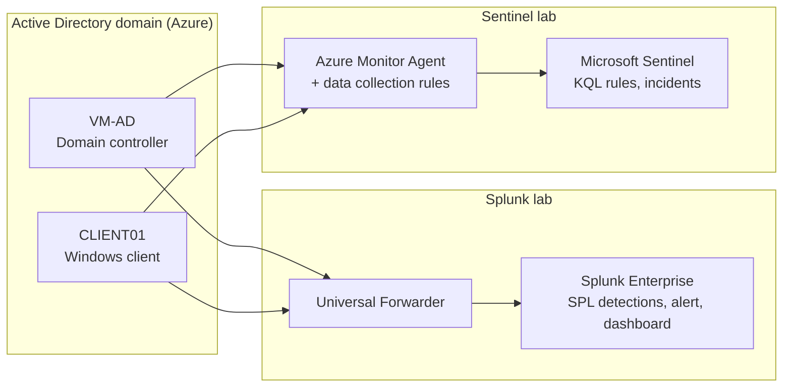

# SIEM Labs: Splunk and Microsoft Sentinel

Two hands-on SIEM labs built on Microsoft Azure that detect the same attacks against the same Active Directory domain, once with a self-managed SIEM (Splunk Enterprise) and once with a cloud-native SIEM (Microsoft Sentinel). Building both shows how the same detection logic is expressed, deployed and operated on two very different platforms.

| Project | What it covers | Status |
|---|---|---|
| **[Splunk SIEM Lab](splunk/README.md)** | Splunk Enterprise on an Ubuntu VM, Universal Forwarder and Sysmon on the endpoints, six SPL detections, a scheduled alert and a monitoring dashboard | Complete |
| **[Microsoft Sentinel SOC Lab](sentinel/README.md)** | Sentinel on a Log Analytics workspace, Azure Monitor Agent with data collection rules, six KQL analytics rules and incidents in the Microsoft Defender portal | In progress (all six detections proven; incident investigated, rules tuned, workbook built; playbook next) |

Both labs use the Windows domain built in the [Azure Active Directory Lab](https://github.com/Osita-Odo/azure-active-directory-lab) as their log source: a domain controller (VM-AD) and a domain-joined client (CLIENT01), both running Sysmon.

## Shared architecture



## Same attacks, two SIEMs

| Attack | Windows event | MITRE ATT&CK | Splunk (SPL) | Sentinel (KQL) |
|---|---|---|---|---|
| Brute-force sign-ins | 4625 | T1110 | [query](splunk/detections/01-brute-force-4625.spl) | [query](sentinel/detections/01-brute-force-4625.kql) |
| Account lockout | 4740 | T1110 | [query](splunk/detections/02-account-lockout-4740.spl) | [query](sentinel/detections/02-account-lockout-4740.kql) |
| Privileged group change | 4728 / 4732 / 4756 | T1098 | [query](splunk/detections/03-privilege-escalation-4728-4732-4756.spl) | [query](sentinel/detections/03-privileged-group-change-4728-4732-4756.kql) |
| New account created | 4720 | T1136 | [query](splunk/detections/04-new-account-4720.spl) | [query](sentinel/detections/04-new-account-4720.kql) |
| Encoded PowerShell | Sysmon 1 | T1059.001 | [query](splunk/detections/05-encoded-powershell-sysmon1.spl) | [query](sentinel/detections/05-encoded-powershell-sysmon1.kql) |
| Service installation | 7045 | T1543.003 | [query](splunk/detections/06-service-install-7045.spl) | [query](sentinel/detections/06-service-install-7045.kql) |

## How the two platforms compared in practice

| | Splunk lab | Sentinel lab |
|---|---|---|
| Hosting | Self-managed Ubuntu VM, Splunk run as a non-root systemd service | Managed service on a Log Analytics workspace |
| Collection | Universal Forwarder, `inputs.conf` / `outputs.conf` | Azure Monitor Agent, data collection rules with XPath filters |
| Query language | SPL | KQL |
| Detection output | Scheduled alert and Triggered Alerts | Analytics rules raising incidents with mapped entities |
| Analyst view | Classic dashboard | Incidents (cases) in the Microsoft Defender portal and a SOC overview workbook |
| Cost model | VM compute | Ingestion volume (kept low with filtered collection) |
| Hardest problem | DNS resolution through the domain controller, and Splunk refusing to run as root | Collection agent never installed, then invisible leading spaces in a pasted XPath filter |

Each project README ends with a full **Challenges and resolutions** section: what went wrong, the cause, the steps taken to diagnose and fix it, and the lesson learned.

## Repository structure

```
.
├── README.md        # This overview
├── splunk/          # Splunk SIEM lab: README, SPL detections, forwarder config, screenshots
└── sentinel/        # Sentinel SOC lab: README, KQL detections, DCR config, screenshots
```

## Skills demonstrated

- Building and operating two SIEM platforms, self-managed and cloud-native, on Microsoft Azure
- Windows and Sysmon log collection with the Splunk Universal Forwarder and the Azure Monitor Agent
- Writing equivalent detections in SPL and KQL, mapped to MITRE ATT&CK
- Simulating attacks against an Active Directory domain and verifying detection end to end
- Troubleshooting ingestion pipelines and tuning detections against real security controls

## Related projects

- [Azure Active Directory Lab](https://github.com/Osita-Odo/azure-active-directory-lab): the Windows domain that feeds both SIEMs.
