# Microsoft Sentinel SOC Lab on Microsoft Azure

A cloud-native SIEM lab built on Microsoft Sentinel. Windows logs from an Active Directory domain are collected with the Azure Monitor Agent, six detections are written in Kusto Query Language (KQL) and mapped to MITRE ATT&CK, and simulated attacks are confirmed as incidents in the Microsoft Defender portal.

This is the Sentinel half of the [SIEM labs](../README.md). It detects the same attacks as the [Splunk SIEM lab](../splunk/README.md), so the two can be compared side by side, and it uses the domain from the [Azure Active Directory Lab](https://github.com/Osita-Odo/azure-active-directory-lab) as its log source.

> **Status: complete.** All six detections are proven by real incidents. A High incident was investigated and decoded from the evidence; the rules were tuned from what the investigation showed (user, payload and service details extracted, entities mapped, alert grouping on) and re-tested; a SOC overview workbook was built and used to triage an unknown account; every test incident was closed with a classification; and a playbook with an automation rule now comments on and tags every new High incident, proven on a live incident.

## Objective

Rebuild a working detection pipeline in a cloud-native SIEM: connect Windows endpoints, write detections as scheduled analytics rules, simulate realistic attacks against the domain, and prove each attack raises an incident with the right entities attached.

## Architecture

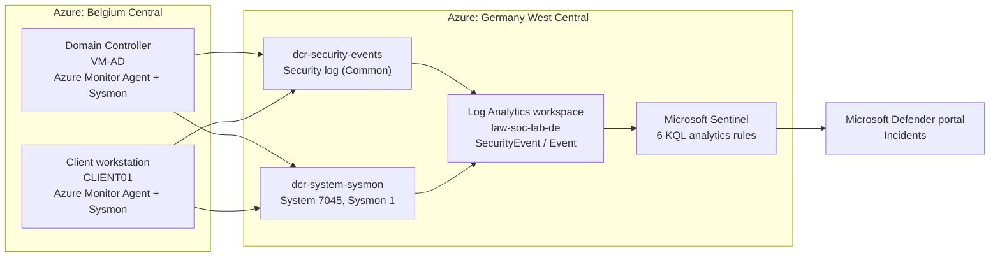

The Azure Monitor Agent on each endpoint follows two data collection rules. One sends Windows Security events to the `SecurityEvent` table; the other sends only System event 7045 and Sysmon event 1 to the `Event` table. Sentinel runs the analytics rules over the workspace and raises incidents in the Defender portal.

### Environment

| Component | Detail |
|---|---|
| SIEM | Microsoft Sentinel, managed through the Microsoft Defender portal |
| Workspace | `law-soc-lab-de`, Germany West Central |
| Licensing | Sentinel free trial: 10 GB/day free for Sentinel and Log Analytics |
| Log sources | Domain controller VM-AD and client CLIENT01 (Belgium Central) |
| Agent | Azure Monitor Agent (AMA) |
| Endpoint telemetry | Sysmon64 (SwiftOnSecurity configuration) |
| Data collection | [`dcr-security-events`](config/dcr-security-events.txt) and [`dcr-system-sysmon`](config/dcr-system-sysmon-xpath.txt) |

> The student email address, university tenant name, subscription and correlation IDs, and the test account password have been redacted from the screenshots. The lab accounts on `ad.terracyb.com` are fictional.

## Detections and MITRE ATT&CK mapping

| Detection | Windows event | MITRE technique | Severity | Status | Query |
|---|---|---|---|---|---|
| Brute-force sign-ins | 4625 | T1110 Brute Force | Medium | Incident raised | [01](detections/01-brute-force-4625.kql) |
| Account lockout | 4740 | T1110 Brute Force | Medium | Incident raised | [02](detections/02-account-lockout-4740.kql) |
| Privileged group change | 4728 / 4732 / 4756 | T1098 Account Manipulation | High | Incident raised | [03](detections/03-privileged-group-change-4728-4732-4756.kql) |
| New account created | 4720 | T1136 Create Account | Medium | Incident raised | [04](detections/04-new-account-4720.kql) |
| Encoded PowerShell | Sysmon 1 | T1059.001 PowerShell | High | Incident raised | [05](detections/05-encoded-powershell-sysmon1.kql) |
| Service installation | 7045 | T1543.003 Windows Service | Medium | Incident raised | [06](detections/06-service-install-7045.kql) |

## How it was built

### Phase 1: Workspace and Sentinel

A Log Analytics workspace was created and Sentinel added to it. The first attempt in Belgium Central, beside the VMs, failed because Sentinel is not offered there (Challenge 1), so the workspace was rebuilt in Germany West Central. Sentinel started on a 31-day free trial, and retention was left at the free default.


### Phase 2: Connect the endpoints

The **Windows Security Events** solution was installed from the Content hub and its **Windows Security Events via AMA** connector used to create `dcr-security-events`. The **Common** event set covers every Security event this lab detects without the cost of "All Security Events".


The first check returned no data. The Azure Monitor Agent had never been installed (Challenge 3), and was installed from the rule's data-flow status page. Both endpoints then passed the checks and Security events arrived.


```kql
SecurityEvent
| summarize Count = count(), LastSeen = max(TimeGenerated) by Computer
```


A second rule, `dcr-system-sysmon`, collects only the two extra events the remaining detections need, using XPath filters on the **Windows Event Logs** data source:

```
System!*[System[(EventID=7045)]]
Microsoft-Windows-Sysmon/Operational!*[System[(EventID=1)]]
```


This rule collected nothing for a long time. The cause turned out to be invisible leading spaces in the saved Sysmon filter (Challenge 4). After the fix, System and Sysmon events arrive from both endpoints.


### Phase 3: Analytics rules

Sentinel analytics are now managed in the Microsoft Defender portal (Challenge 2). Each detection is a **scheduled query rule** with a MITRE mapping, a KQL query, entity mapping (Account, Host, IP), a schedule and an alert threshold of "greater than 0".


### Phase 4: Simulate attacks and verify incidents

A fresh test account was created on the domain controller, added to Domain Admins, and then brute-forced from the client:

```powershell
# On VM-AD (as administrator)
New-ADUser -Name "svc_sentinel" -SamAccountName "svc_sentinel" -AccountPassword (ConvertTo-SecureString "<14+ character password>" -AsPlainText -Force) -Enabled $true
Add-ADGroupMember -Identity "Domain Admins" -Members "svc_sentinel"

# On CLIENT01
1..8 | ForEach-Object { net use \\VM-AD\IPC$ /user:AD\svc_sentinel "WrongPass$_" 2>$null }
```


All four Security-event rules raised incidents, with the host and account entities attached:


| Rule | Result | Entities captured |
|---|---|---|
| New account created (4720) | Incident | VM-AD, AD\svc_sentinel |
| Privileged group change | Incident (High) | VM-AD, AD\osita as the actor |
| Account lockout (4740) | Incident | VM-AD and CLIENT01, svc_sentinel |
| Brute-force sign-ins (4625) | Incident, after tuning (Challenge 5) | CLIENT01, svc_sentinel |

Once Sysmon collection was fixed (Challenge 4), the last two attacks were run on VM-AD. Both are harmless: the first only prints text, and the service is created but never started.

```powershell
$c = [Convert]::ToBase64String([Text.Encoding]::Unicode.GetBytes('Write-Output "sentinel test"'))
powershell -NoProfile -EncodedCommand $c
sc.exe create TestSvc binPath= "cmd.exe /c echo test"
```


All six rules raised incidents:


| Rule | Result | Entities captured |
|---|---|---|
| New account created (4720) | Incident | VM-AD, AD\svc_sentinel |
| Privileged group change | Incident (High) | VM-AD, AD\osita as the actor |
| Account lockout (4740) | Incident | VM-AD and CLIENT01, svc_sentinel |
| Brute-force sign-ins (4625) | Incident, after tuning (Challenge 5) | CLIENT01, svc_sentinel |
| Encoded PowerShell (Sysmon 1) | Incident (High) | VM-AD only at first; host and user mapped after tuning (Challenge 9) |
| Service installation (7045) | Incident | None at first; host mapped after tuning (Challenge 9) |

The first four attacks produced nine incidents; the duplicates and their fix are covered in Challenge 6.

**Clean-up.** The live test changes were then reversed. The incidents and logs remain as evidence.

```powershell
sc.exe delete TestSvc
Remove-ADGroupMember -Identity "Domain Admins" -Members "svc_sentinel" -Confirm:$false
Disable-ADAccount -Identity "svc_sentinel"
```

### Phase 5: Investigate, tune, monitor and automate

#### 5.1 Investigate and close an incident

Raising an incident is only half of the SOC job. The Encoded PowerShell incident was worked the way an analyst would: scope it, establish what ran from the evidence, judge it, document the reasoning, close it.

1. **Scope.** One alert, one device (VM-AD), first and last activity at the same second: a single, isolated execution with no related alerts.
2. **Gap noted.** No user entity, because the rule maps only the host (Challenge 9).
3. **Evidence.** The alert does not show the command line, so it was taken from the Sysmon event, with KQL extracting the encoded payload into its own column:

```kql
Event
| where EventLog == "Microsoft-Windows-Sysmon/Operational" and EventID == 1
| where RenderedDescription has "EncodedCommand"
| extend Encoded = extract(@"-EncodedCommand\s+(\S+)", 1, RenderedDescription)
| project TimeGenerated, Computer, Encoded, RenderedDescription
```

4. **Decode.** PowerShell encodes commands as UTF-16, so the payload was decoded as Unicode:

```powershell
[Text.Encoding]::Unicode.GetString([Convert]::FromBase64String("VwByAGkAdABlAC0ATwB1AHQAcAB1AHQAIAAiAHMAZQBuAHQAaQBuAGUAbAAgAHQAZQBzAHQAIgA="))
# Output: Write-Output "sentinel test"
```

5. **Judge and close.** Benign, authorised testing. Assigned, resolved and classified as *Informational, expected activity - Security testing*, with the reasoning recorded on the incident.


#### 5.2 Tune the rules from what the investigation showed

The investigation exposed two weaknesses an analyst would raise with the detection team: incident 11 named the device but not the user, and the Service installation incidents named nothing (Challenge 9). Earlier attacks had also opened several incidents for the same activity (Challenge 6). Both were fixed in the rules:

- **Encoded PowerShell:** the query now extracts the user and the encoded payload from the Sysmon event, so the payload is on the alert without a separate search. Host is mapped by `FullName` (the `Computer` column holds the fully qualified name) and a new Account entity uses `AccountName` and `AccountDomain` ([query](detections/05-encoded-powershell-sysmon1.kql)).
- **Service installation:** the query now extracts the service name, file and account, and the host is mapped ([query](detections/06-service-install-7045.kql)).
- **All six rules:** alert grouping enabled, alerts within 5 hours grouped into one incident when all entities match.

The `where` lines are unchanged, so both rules fire on exactly the same events as before.

```kql
Event
| where EventLog == "Microsoft-Windows-Sysmon/Operational" and EventID == 1
| where RenderedDescription has "EncodedCommand"
| extend User = extract(@"User: (\S+)", 1, RenderedDescription)
| extend AccountDomain = tostring(split(User, "\\")[0]),
         AccountName   = tostring(split(User, "\\")[1])
| extend EncodedPayload = extract(@"-EncodedCommand\s+(\S+)", 1, RenderedDescription)
| project TimeGenerated, Computer, User, AccountName, AccountDomain, EncodedPayload
```


#### 5.3 Re-test

The encoded command was run twice on VM-AD to test the new entities and alert grouping together, and a second test service was created:

```powershell
$cmd = 'Write-Output "sentinel entity test"'
$enc = [Convert]::ToBase64String([Text.Encoding]::Unicode.GetBytes($cmd))
powershell.exe -EncodedCommand $enc
powershell.exe -EncodedCommand $enc    # about a minute later
sc.exe create TestSvc2 binPath= "C:\Windows\System32\cmd.exe /c echo test" start= demand
```

The updated rules raised **incident 14** (Encoded PowerShell, High) and **incident 15** (Service installation, Medium). Two runs produced one new incident instead of two, which shows alert grouping working. `TestSvc2` was then deleted; the incidents and logs remain as evidence.


Opening the incidents confirmed the entity fix:

- **Incident 14:** two assets, the device VM-AD and the user `osita`. Incident 11 showed the device only.
- **Incident 15:** the device VM-AD. Service installation incidents previously had no assets. No user is expected, because event 7045 records the service account (LocalSystem), not a person.

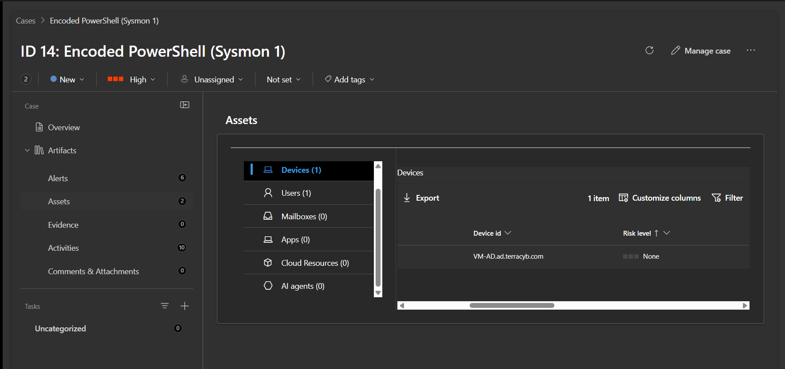

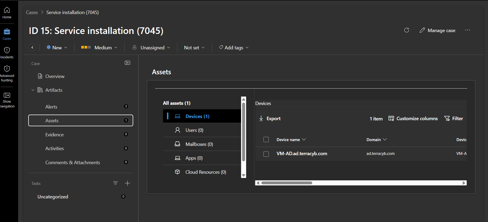

**Known limitation.** Incident 14 holds 6 alerts and incident 15 holds 3. Each rule runs every 10 minutes over a 30-minute lookback, so every event is matched by three consecutive runs. Alert grouping keeps them in one incident, so the queue is clean, but the alert count is inflated. Query suppression (pause 30 minutes after an alert) would remove the duplicates; a lookback equal to the run frequency would too, at the risk of missing late-arriving logs.

#### 5.4 SOC Lab Overview workbook

A workbook gives the analyst the state of the environment at a glance, as the Splunk dashboard did in the other lab. It has four panels, all on the last seven days ([queries](workbook/soc-lab-overview-queries.kql)):

| Panel | Visualisation | Shows |
|---|---|---|
| Incidents by Severity | Pie chart | 15 incidents: 9 Medium, 6 High |
| Alerts by Detection Rule | Bar chart | 31 alerts; Account lockout the noisiest (9), because every brute-force test locked the account |
| Top 10 Accounts with Failed Sign-ins | Bar chart | Accounts failing to sign in |
| Open Incidents | Grid | Incidents not yet closed, newest first |

Sentinel writes a new `SecurityIncident` row every time an incident changes, so the incident panels use `arg_max(TimeGenerated, *) by IncidentNumber` to keep only the latest version of each incident. Without it, incidents would be counted several times and closed ones would still appear as open.


#### 5.5 Triage an unknown account found in the workbook

The failed sign-ins panel showed five failures for a Microsoft account (`MicrosoftAccount\<name>`, redacted) that is not a lab account. Every unknown account failing to sign in has to be explained before it is dismissed:

```kql
SecurityEvent
| where EventID == 4625 and TargetAccount has "<account name>"
| project TimeGenerated, Computer, TargetAccount, LogonType, IpAddress, WorkstationName, Status, SubStatus
| order by TimeGenerated desc
```

- All five targeted CLIENT01 with logon type 3, the credential check Remote Desktop makes before a session opens.
- Two came from the analyst's home network (30 October) and three from another network the analyst used (28 October). The workstation was the analyst's own laptop. Addresses and names are redacted.
- **Verdict: benign.** The Remote Desktop client offered the laptop's Microsoft account before the lab credentials were typed. No attempt came from an unknown source, which also shows the NSG restriction on Remote Desktop working. Action: clear the saved credential in the Remote Desktop client.

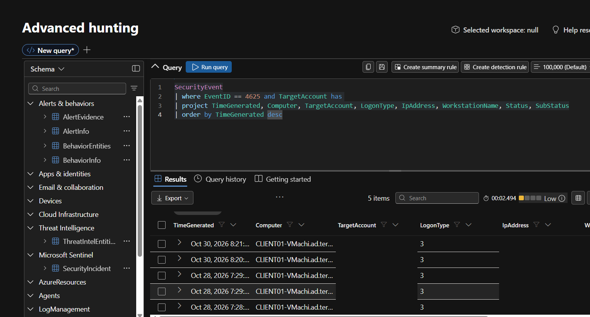

#### 5.6 Close the test incidents

All ten open cases were closed in one bulk action: assigned to the analyst, status Resolved, **Benign Positive, Security Testing**, with a comment recording the authorised attack simulation. Severity was left unchanged, because it records what the rule detected; the classification records what the activity turned out to be.

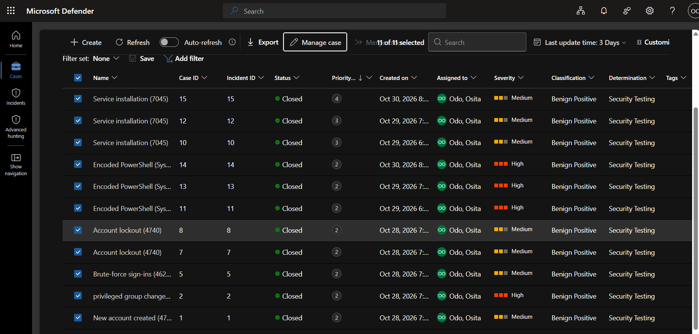

#### 5.7 Automated response: playbook and automation rule

Every High incident needs the same first steps, so they are automated. The playbook `pb-notify-high-incident` (Logic App, Consumption) runs three steps:

1. **Microsoft Sentinel incident** trigger.
2. **Add comment to incident (V3):** a triage checklist with the incident's severity and creation time, inserted as dynamic values.
3. **Update incident:** adds the tag `auto-triaged`.

An automation rule, **Run triage playbook on High incidents** (When incident is created, Severity equals High, Run Logic App playbook), starts it. The playbook's managed identity has **Microsoft Sentinel Responder** on the resource group: enough to comment on and update incidents, not enough to change rules or settings.

The first design sent an email; it was replaced because the university mailbox cannot be used by the Outlook connector (Challenge 12). Getting the playbook to run needed three more fixes (Challenges 13 to 15).

**Test.** An encoded PowerShell command on VM-AD raised **incident 16** (High) at 23:51 on 30 October, and the automation rule started the playbook two seconds later. After the role fix, the run was resubmitted and all three steps succeeded:

- tag `auto-triaged` added;
- comment posted by *Playbook-pb-notify-high-incident*: "Severity: High | Created (UTC): 2026-10-30T22:51:09" and the checklist;
- the incident graph links VM-AD to the user `osita`, confirming the entity fix on a new attack.

Incident 16 was then closed as Benign Positive, Security Testing.


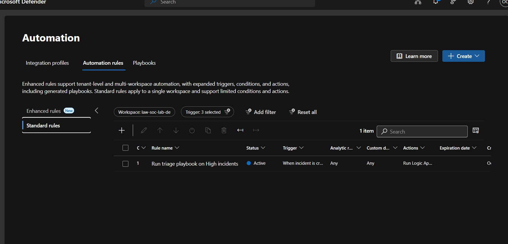

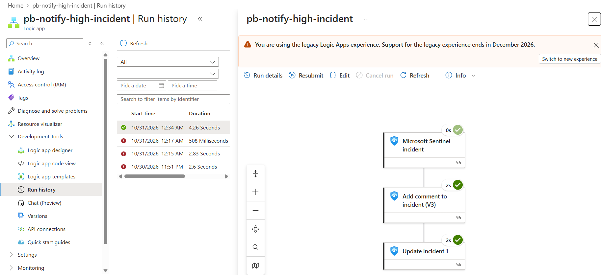

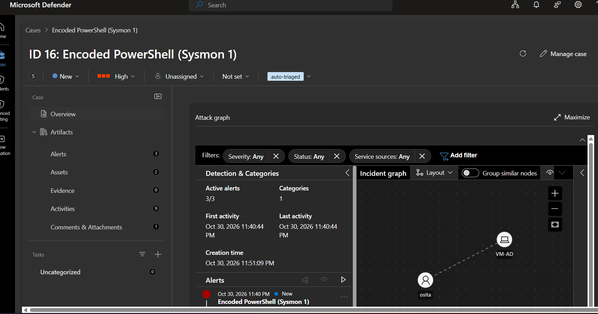

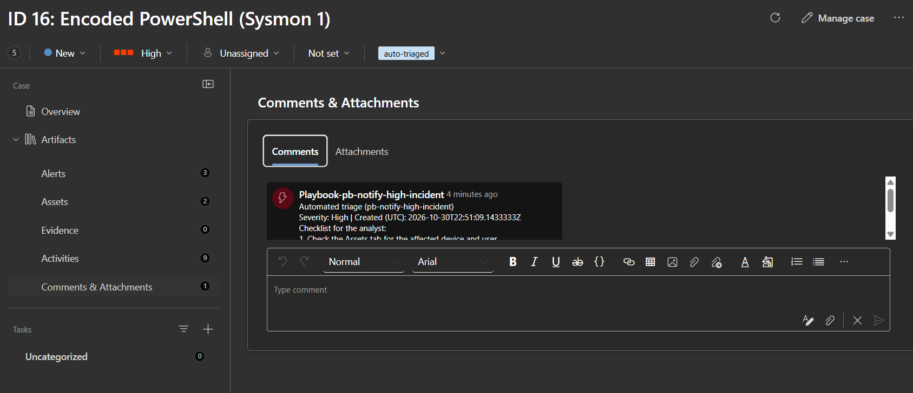

## Possible extensions

1. Add a notification step to the playbook (Microsoft Teams, or email from a mailbox hosted in Exchange Online).
2. Apply query suppression to the Sysmon and System rules to remove the duplicate alerts inside an incident.
3. Onboard the VMs to Microsoft Defender for Endpoint to add EDR alerts alongside the log-based rules.

## Repository contents

```
sentinel/
├── README.md
├── detections/   # KQL analytics rule queries, one per technique
├── workbook/     # KQL queries for the SOC Lab Overview workbook panels
├── config/       # Data collection rule settings and XPath filters
└── images/       # Redacted screenshots used in this README
```

## Challenges and resolutions

### Challenge 1: Sentinel not available in Belgium Central

**What happened.** The first workspace, in Belgium Central, was listed but could not be selected when adding Sentinel, with a banner saying Sentinel runs only in specific regions.

**Cause.** Belgium Central is one of Azure's newest regions and Sentinel is not yet offered there. The student tenant also blocks non-EU regions, so the replacement had to be in the EU.

**Steps to resolve.**
1. Created a new workspace, `law-soc-lab-de`, in Germany West Central (supported, EU, data stays in Germany).
2. Used a different name so Azure would not recover the soft-deleted Belgium workspace instead.
3. Added Sentinel to the new workspace, which was selectable immediately.
4. Deleted the empty Belgium workspace.

**Outcome.** Resolved. The VMs stayed in Belgium Central; the agent sends logs across regions at negligible cost.


### Challenge 2: Sentinel pages moved to the Defender portal

**What happened.** Opening Analytics in the Azure portal showed "This page has been moved to the Defender portal".

**Cause.** New Sentinel workspaces are onboarded to the unified Microsoft Defender portal automatically.

**Steps to resolve.** Followed the link and built all rules in Defender (Analytics, Create, Scheduled query rule); incidents are reviewed there too. Logs, connectors and data collection rules remain in the Azure portal.

**Outcome.** Resolved.

### Challenge 3: No Security events, because the agent was never installed

**What happened.** The ingestion query returned no results for 24 hours despite the data collection rule being created successfully.

**Cause.** The rule deploys the agent when it is associated with a VM, but the VMs were deallocated straight after the rule was created. The deployment never ran, and a stopped VM does not retry it.

**Steps to resolve.**
1. Switched the Logs editor to KQL mode and widened the time range to rule out a query mistake.
2. Checked VM-AD's extensions: `AzureMonitorWindowsAgent` was missing.
3. Checked the VM Guest Agent was "Ready", ruling out a broken guest agent.
4. Looked in the extensions gallery: only third-party agents appeared, and these were deliberately not installed, because the Azure Monitor Agent is deployed through data collection rules.
5. Opened the rule's Resources page: both VMs showed "Needs attention".
6. The data-flow detail stated "Azure Monitor Agent is not installed on this virtual machine", with an **Install agent** action, used on each VM.
7. Both VMs passed the checks and events arrived within minutes.

**Outcome.** Resolved. Lesson: keep VMs running after creating a data collection rule until its resources show "Passed initial checks".


### Challenge 4: Event table empty, caused by leading spaces in the Sysmon filter

**What happened.** `dcr-system-sysmon` delivered nothing to the `Event` table for hours, although every setting looked correct in the portal.

**Steps to diagnose and resolve.** Each link in the chain was tested in turn:
1. Listed every table receiving data (`union * | summarize count() by Type`): only SecurityEvent, Heartbeat and Usage.
2. Rule association: both VMs "Passed initial checks".
3. Sysmon64 running on VM-AD and logging event 1 every few seconds.
4. Data source: both XPath filters present; destination set to the workspace.
5. Rule JSON view: `dataFlows` sends `Microsoft-Event` to the workspace; provisioning Succeeded.
6. Agent's local copy of the rule on VM-AD: both filters present, stream `GENERIC_EVENT_BLOB` (the agent's internal name for the Event table).
7. Workspace error log (`_LogOperation`): no ingestion errors.
8. Agent restart: `Restart-Service` failed because on Windows the agent runs as extension-managed processes, not a service; both VMs were restarted from the portal instead, with no change.
9. Added a broad test filter (`System!*`) and saved: System events started arriving, proving the pipeline worked.
10. Filtered for Sysmon: zero rows while System events flowed, so the fault was specific to the Sysmon filter.
11. Re-read the agent's local configuration and found the cause: the Sysmon filter was saved as `"   Microsoft-Windows-Sysmon/Operational..."`, with three leading spaces, most likely from pasting. The agent looked for a log by that exact name, found none, and collected nothing. The portal trims leading spaces in its display, so the filter looked correct there.
12. Deleted the Sysmon entry and the test filter, cleared the input box, typed the filter by hand, and saved.
13. Confirmed on VM-AD that the agent downloaded the new configuration (fresh timestamp) and the filter now has no leading spaces.
14. Within minutes, Sysmon event 1 arrived in the `Event` table from both endpoints.

**Root cause.** Leading whitespace in a pasted XPath filter. It passed portal validation and was invisible in the portal view.

**Outcome.** Resolved. Lesson: type XPath filters by hand, and when a data collection rule looks right but collects nothing, read the agent's local copy of the rule rather than trusting the portal view.


### Challenge 5: Brute-force rule did not fire

**What happened.** The brute-force attack produced only four 4625 events (three on CLIENT01, one on VM-AD) and no incident.

**Cause.** The lockout policy from the AD lab locked the account after about three failures, so the attack never reached the original threshold of more than five: the preventive control stopped the attack before the detective control saw enough attempts. The original query also grouped by account, source and computer, splitting the failures across two machines.

**Steps to resolve.**
1. Compared the event counts with the rule threshold and the lockout policy.
2. Rewrote the query to count failures per account across all machines and fire at three, matching the lockout threshold ([query](detections/01-brute-force-4625.kql)). Column names were kept so the entity mapping still worked.
3. Re-ran the brute-force loop.

**Outcome.** Resolved; the brute-force incident was raised. Lesson: tune detection thresholds to the preventive controls in place.

### Challenge 6: Duplicate incidents

**What happened.** Four attacks produced nine incidents, for example three for the same new account.

**Cause.** Each rule looks back further than it runs (every 10 minutes over the last 30, for example), so consecutive runs matched the same event and each opened a new incident. In a real SOC this is alert fatigue.

**Steps to resolve.**
1. On each of the six rules: Edit, Incident settings, Alert grouping enabled, alerts within 5 hours grouped into one incident when all entities match, Review + create, Save.
2. Checked each rule's *Last modified* date on the Analytics page to confirm the change had saved.
3. Re-tested by running the same encoded PowerShell command twice.

**Outcome.** Resolved. Two runs produced one new incident (14) instead of two; the duplicate alerts inside an incident are explained in Phase 5.3. Lesson: set alert grouping when a rule is created, not after the incident queue fills up.

### Challenge 7: `Unlock-ADAccount` not recognised

**What happened.** Unlocking the test account before repeating the brute-force test returned "not recognized as the name of a cmdlet".

**Cause.** It was run on CLIENT01; the Active Directory PowerShell module is only on the domain controller.

**Steps to resolve.** Confirmed that failed attempts against the locked account still log 4625 (with a locked-out status), which is all the rule needs, so no unlock was required. AD commands run on VM-AD; the `net use` attack runs on CLIENT01.

**Outcome.** Resolved without further action.

### Challenge 8: Typo in a rule name

**What happened.** The privileged group change rule was saved as "rivileged group change", which would appear on every incident.

**Steps to resolve.** Analytics, the rule, Edit, General, corrected the name, Save.

**Outcome.** Resolved; the name was later capitalised to "Privileged group change". Incidents raised before the fix keep the old name, because an incident keeps the name it was created with.

### Challenge 9: Incomplete entity mapping on two rules

**What happened.** The Service installation incident showed no impacted assets at all, and the Encoded PowerShell incident showed a device but no user, so neither said who was involved.

**Cause.** Entities only appear on an incident if the rule maps them. The service installation rule had no mapping, and the encoded PowerShell rule mapped only the host, because its query does not extract the user from the Sysmon event text.

**Steps to resolve.**
1. Compared impacted assets across incidents: every other rule shows a host and an account.
2. Service installation: rewrote the query to extract the service name, file and account, and mapped Host with identifier `FullName` to `Computer` (FullName rather than HostName, because `Computer` holds the fully qualified name).
3. Encoded PowerShell: rewrote the query to extract the user (split into `AccountName` and `AccountDomain`) and the encoded payload, changed the Host identifier to `FullName`, and added an Account entity.
4. Re-ran both attacks; the updated rules raised incidents 14 and 15.

**Outcome.** Resolved. Incident 14 shows the device and the user `osita`, incident 15 shows the device, and incident 16 confirmed it again on a new attack. Lesson: test that every rule returns the entities an analyst needs, not just that it fires.

### Challenge 10: Decoding the payload failed twice

**What happened.** The first decode returned "The input is not a valid Base-64 string", and the next attempt nearly failed the same way.

**Cause.** The first attempt still contained the placeholder text instead of the payload. The second copied value had lost its final `=`. Base64 is written in blocks of four characters with `=` as padding; the copied string was 75 characters long, so it was invalid without it.

**Steps to resolve.**
1. Took the value from the log rather than retyping it.
2. Added a KQL `extract()` so the payload sits in its own column, which is easier to copy accurately than a long event description.
3. Checked the length (75 is not a multiple of four), recopied the full value including the `=`, and decoded it.

**Outcome.** Resolved. Lesson: take evidence directly from the source, and know enough about the encoding to spot a truncated value.

### Challenge 11: Portal labels changed again during the build

**What happened.** Instructions did not match the screen: incidents were now listed under **Cases** (with a Case ID beside the Incident ID), and the workbook editor had no *Add query* option.

**Cause.** Microsoft is still reorganising the unified Defender portal (see Challenge 2). Incidents are now managed as cases, and *Add query* was renamed *Add data source + visualization*.

**Steps to resolve.** Matched each new label to the documented function, and confirmed the function was unchanged by checking the panel settings (data source, workspace, time range, visualisation, query).

**Outcome.** Resolved. Lesson: in cloud consoles, follow the function rather than the exact label, and record the label in use on the date of the build.

### Challenge 12: The playbook could not send email from the university mailbox

**What happened.** Signing in to the Office 365 Outlook connector returned 404, "REST API is not yet supported for this mailbox" (`MailboxNotEnabledForRESTAPI`).

**Cause.** The connector needs a mailbox in Exchange Online. The university mailbox is hosted on the university's own mail server, and the lab subscription sits in the university tenant, so this is outside the analyst's control.

**Steps to resolve.**
1. Read the error code, which names the mailbox type rather than a permission problem.
2. Removed the email steps.
3. Redesigned the response to write back to the incident (comment and tag) through the existing Sentinel connection, which needs no mailbox.

**Outcome.** Resolved by design change. Writing to the incident is a standard SOAR response and cannot be blocked by mail policy; notification is listed as an extension.

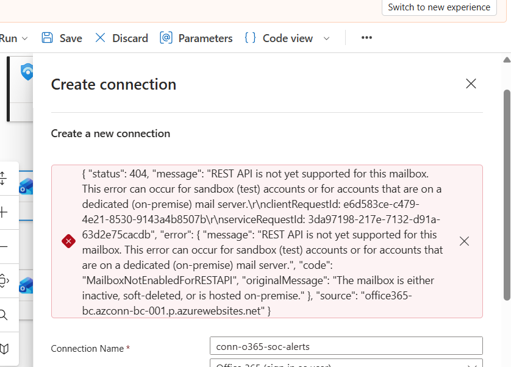

### Challenge 13: A look-alike third-party connector

**What happened.** Searching for *Update incident* offered an action with the same name that asked for an API key. Its panel said it was an **Independent Publisher** connector, provided "as is" and not supported by Microsoft.

**Cause.** Connector actions are searched by name across all publishers, so different products can offer identically named actions.

**Steps to resolve.**
1. Closed the panel without entering anything and deleted the empty step.
2. Searched for *Microsoft Sentinel* and chose *Update incident* from the Microsoft Sentinel connector (blue shield), reusing the existing connection.

**Outcome.** Resolved. Lesson: check the publisher before adding a connector to security tooling; an unknown third-party connector holding an API key is a supply-chain risk.

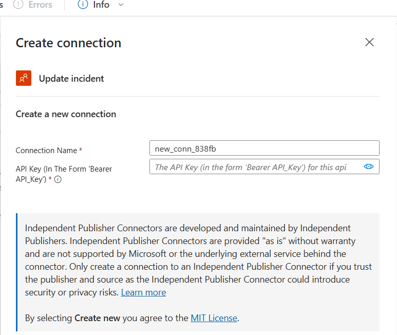

### Challenge 14: Sentinel could not be given permission to run the playbook

**What happened.** The playbook was greyed out in the automation rule. *Manage playbook permissions* failed with "Service principal not found for application ID 58131f34-…", and the selected playbook showed *Missing permissions*.

**Cause.** The Defender portal grants the permission to its own service identity, which does not exist in the university tenant; only a tenant administrator could add it.

**Steps to resolve.**
1. Granted it manually: resource group, Access control (IAM), **Microsoft Sentinel Automation Contributor** for **Azure Security Insights**. Azure reported the assignment already existed, created by the first, partly successful attempt.
2. Saved the automation rule (Standard rule) despite the warning.
3. Tested with a real High incident: the rule started the playbook two seconds after incident 16 was created.

**Outcome.** Resolved. The warning reflects the portal's check for the missing identity, not the permission the rule uses. Lesson: when a portal check and the real behaviour disagree, test the behaviour.

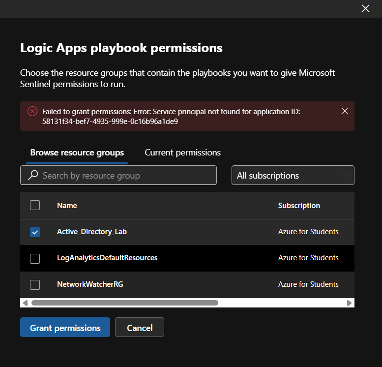

### Challenge 15: Playbook runs failed: Forbidden, then empty manual runs

**What happened.** The automated run for incident 16 failed at *Add comment to incident* with **Forbidden**. Two later runs failed with **BadRequest**, inner error "Incident Arm id missing".

**Cause.** Two separate causes. The Sentinel connection authenticates as the playbook's managed identity, which had no role on the workspace, so it could read the incident but not change it. The BadRequest runs had been started with *Run* in the designer: their raw inputs showed an empty request body sent from the browser, so every dynamic value was null.

**Steps to resolve.**
1. Read the failed step's status: Forbidden.
2. Assigned **Microsoft Sentinel Responder** to the Logic App's managed identity on the resource group (least privilege for comments and updates).
3. Inspected the BadRequest runs: `incidentArmId` null, and a manual trigger with an empty body.
4. Resubmitted the original automated run for incident 16, which replays the real incident data.
5. All three steps succeeded; the tag and comment appeared on incident 16.

**Outcome.** Resolved. Lessons: give a playbook identity the least role it needs, and test a playbook by resubmitting a real run, not by running the trigger by hand.

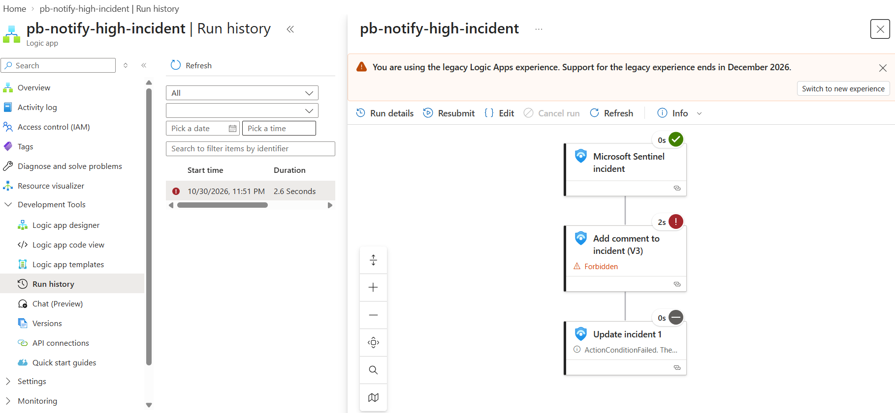

## Skills demonstrated

- Deploying Microsoft Sentinel on a Log Analytics workspace and working within regional and tenant constraints
- Collecting Windows Security, System and Sysmon logs with the Azure Monitor Agent and data collection rules, including XPath filtering for cost control
- Writing KQL analytics rules mapped to MITRE ATT&CK, with entity mapping and scheduling
- Simulating attacks against an Active Directory domain and verifying incidents in the Defender portal
- Systematic troubleshooting of an ingestion pipeline from the portal down to the agent's local configuration
- Detection tuning: aligning thresholds with lockout policy and diagnosing duplicate incidents
- Incident triage: scoping an incident, extracting and decoding an obfuscated PowerShell payload from the evidence, and closing it with a documented classification
- Improving detections from investigation findings: extracting context into the alert, mapping host and account entities, and grouping alerts to reduce duplicate incidents
- Building a Sentinel workbook for an at-a-glance SOC view, and triaging an unexpected account found in it with advanced hunting
- Automating first response with a Logic App playbook and automation rule, including least-privilege managed identity and troubleshooting failed runs
