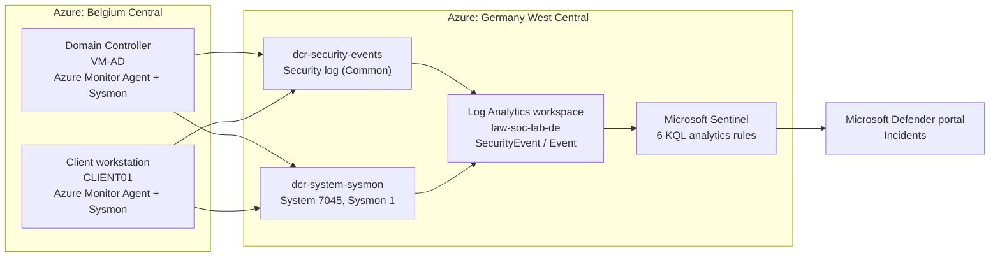

# Microsoft Sentinel SOC Lab on Microsoft Azure

A cloud-native SIEM lab built on Microsoft Sentinel. Windows logs from an Active Directory domain are collected with the Azure Monitor Agent, six detections are written in Kusto Query Language (KQL) and mapped to MITRE ATT&CK, and simulated attacks are confirmed as incidents in the Microsoft Defender portal.

This is the Sentinel half of the [SIEM labs](../README.md). It detects the same attacks as the [Splunk SIEM lab](../splunk/README.md), so the two can be compared side by side, and it uses the domain from the [Azure Active Directory Lab](https://github.com/Osita-Odo/azure-active-directory-lab) as its log source.

> **Status: in progress.** Phases 1 to 4 are built. Four of the six detections are proven by real incidents. All data sources are now flowing, including Sysmon after the fix in Challenge 4. The encoded PowerShell and service installation attacks are the next step, followed by investigation, a workbook and an automated response playbook.

## Objective

Rebuild a working detection pipeline in a cloud-native SIEM: connect Windows endpoints, write detections as scheduled analytics rules, simulate realistic attacks against the domain, and prove each attack raises an incident with the right entities attached.

## Architecture



The Azure Monitor Agent on each endpoint follows two data collection rules. One sends Windows Security events to the `SecurityEvent` table; the other sends only System event 7045 and Sysmon event 1 to the `Event` table. Sentinel runs the analytics rules over the workspace and raises incidents in the Defender portal.

### Environment

| Component | Detail |
|---|---|
| SIEM | Microsoft Sentinel, managed through the Microsoft Defender portal |
| Workspace | `law-soc-lab-de`, Germany West Central |
| Licensing | Sentinel free trial: 10 GB/day free for Sentinel and Log Analytics |
| Log sources | Domain controller VM-AD and client CLIENT01 (Belgium Central) |
| Agent | Azure Monitor Agent (AMA) |
| Endpoint telemetry | Sysmon64 (SwiftOnSecurity configuration) |
| Data collection | [`dcr-security-events`](config/dcr-security-events.txt) and [`dcr-system-sysmon`](config/dcr-system-sysmon-xpath.txt) |

> The student email address, university tenant name, subscription and correlation IDs, and the test account password have been redacted from the screenshots. The lab accounts on `ad.terracyb.com` are fictional.

## Detections and MITRE ATT&CK mapping

| Detection | Windows event | MITRE technique | Severity | Status | Query |
|---|---|---|---|---|---|
| Brute-force sign-ins | 4625 | T1110 Brute Force | Medium | Incident raised | [01](detections/01-brute-force-4625.kql) |
| Account lockout | 4740 | T1110 Brute Force | Medium | Incident raised | [02](detections/02-account-lockout-4740.kql) |
| Privileged group change | 4728 / 4732 / 4756 | T1098 Account Manipulation | High | Incident raised | [03](detections/03-privileged-group-change-4728-4732-4756.kql) |
| New account created | 4720 | T1136 Create Account | Medium | Incident raised | [04](detections/04-new-account-4720.kql) |
| Encoded PowerShell | Sysmon 1 | T1059.001 PowerShell | High | Rule live, attack pending | [05](detections/05-encoded-powershell-sysmon1.kql) |
| Service installation | 7045 | T1543.003 Windows Service | Medium | Rule live, attack pending | [06](detections/06-service-install-7045.kql) |

## How it was built

### Phase 1: Workspace and Sentinel

A Log Analytics workspace was created and Sentinel added to it. The first attempt in Belgium Central, beside the VMs, failed because Sentinel is not offered there (Challenge 1), so the workspace was rebuilt in Germany West Central. Sentinel started on a 31-day free trial, and retention was left at the free default.


### Phase 2: Connect the endpoints

The **Windows Security Events** solution was installed from the Content hub and its **Windows Security Events via AMA** connector used to create `dcr-security-events`. The **Common** event set covers every Security event this lab detects without the cost of "All Security Events".


The first check returned no data. The Azure Monitor Agent had never been installed (Challenge 3), and was installed from the rule's data-flow status page. Both endpoints then passed the checks and Security events arrived.


```kql
SecurityEvent
| summarize Count = count(), LastSeen = max(TimeGenerated) by Computer
```


A second rule, `dcr-system-sysmon`, collects only the two extra events the remaining detections need, using XPath filters on the **Windows Event Logs** data source:

```
System!*[System[(EventID=7045)]]
Microsoft-Windows-Sysmon/Operational!*[System[(EventID=1)]]
```


This rule collected nothing for a long time. The cause turned out to be invisible leading spaces in the saved Sysmon filter (Challenge 4). After the fix, System and Sysmon events arrive from both endpoints.


### Phase 3: Analytics rules

Sentinel analytics are now managed in the Microsoft Defender portal (Challenge 2). Each detection is a **scheduled query rule** with a MITRE mapping, a KQL query, entity mapping (Account, Host, IP), a schedule and an alert threshold of "greater than 0".


### Phase 4: Simulate attacks and verify incidents

A fresh test account was created on the domain controller, added to Domain Admins, and then brute-forced from the client:

```powershell
# On VM-AD (as administrator)
New-ADUser -Name "svc_sentinel" -SamAccountName "svc_sentinel" -AccountPassword (ConvertTo-SecureString "<14+ character password>" -AsPlainText -Force) -Enabled $true
Add-ADGroupMember -Identity "Domain Admins" -Members "svc_sentinel"

# On CLIENT01
1..8 | ForEach-Object { net use \\VM-AD\IPC$ /user:AD\svc_sentinel "WrongPass$_" 2>$null }
```


All four Security-event rules raised incidents, with the host and account entities attached:


| Rule | Result | Entities captured |
|---|---|---|
| New account created (4720) | Incident | VM-AD, AD\svc_sentinel |
| Privileged group change | Incident (High) | VM-AD, AD\osita as the actor |
| Account lockout (4740) | Incident | VM-AD and CLIENT01, svc_sentinel |
| Brute-force sign-ins (4625) | Incident, after tuning (Challenge 5) | CLIENT01, svc_sentinel |

Four attacks produced nine incidents. The duplicates and their fix are covered in Challenge 6.

## Next steps

1. Run the encoded PowerShell and service installation attacks and confirm both incidents.
2. Turn on alert grouping on every rule (Challenge 6).
3. Investigate a High incident, build a workbook, and create a SOAR playbook (Logic App).
4. Clean up the test account and service.

## Repository contents

```
sentinel/
├── README.md
├── detections/   # KQL analytics rule queries, one per technique
├── config/       # Data collection rule settings and XPath filters
└── images/       # Redacted screenshots used in this README
```

## Challenges and resolutions

### Challenge 1: Sentinel not available in Belgium Central

**What happened.** The first workspace, in Belgium Central, was listed but could not be selected when adding Sentinel, with a banner saying Sentinel runs only in specific regions.

**Cause.** Belgium Central is one of Azure's newest regions and Sentinel is not yet offered there. The student tenant also blocks non-EU regions, so the replacement had to be in the EU.

**Steps to resolve.**
1. Created a new workspace, `law-soc-lab-de`, in Germany West Central (supported, EU, data stays in Germany).
2. Used a different name so Azure would not recover the soft-deleted Belgium workspace instead.
3. Added Sentinel to the new workspace, which was selectable immediately.
4. Deleted the empty Belgium workspace.

**Outcome.** Resolved. The VMs stayed in Belgium Central; the agent sends logs across regions at negligible cost.


### Challenge 2: Sentinel pages moved to the Defender portal

**What happened.** Opening Analytics in the Azure portal showed "This page has been moved to the Defender portal".

**Cause.** New Sentinel workspaces are onboarded to the unified Microsoft Defender portal automatically.

**Steps to resolve.** Followed the link and built all rules in Defender (Analytics, Create, Scheduled query rule); incidents are reviewed there too. Logs, connectors and data collection rules remain in the Azure portal.

**Outcome.** Resolved.

### Challenge 3: No Security events, because the agent was never installed

**What happened.** The ingestion query returned no results for 24 hours despite the data collection rule being created successfully.

**Cause.** The rule deploys the agent when it is associated with a VM, but the VMs were deallocated straight after the rule was created. The deployment never ran, and a stopped VM does not retry it.

**Steps to resolve.**
1. Switched the Logs editor to KQL mode and widened the time range to rule out a query mistake.
2. Checked VM-AD's extensions: `AzureMonitorWindowsAgent` was missing.
3. Checked the VM Guest Agent was "Ready", ruling out a broken guest agent.
4. Looked in the extensions gallery: only third-party agents appeared, and these were deliberately not installed, because the Azure Monitor Agent is deployed through data collection rules.
5. Opened the rule's Resources page: both VMs showed "Needs attention".
6. The data-flow detail stated "Azure Monitor Agent is not installed on this virtual machine", with an **Install agent** action, used on each VM.
7. Both VMs passed the checks and events arrived within minutes.

**Outcome.** Resolved. Lesson: keep VMs running after creating a data collection rule until its resources show "Passed initial checks".


### Challenge 4: Event table empty, caused by leading spaces in the Sysmon filter

**What happened.** `dcr-system-sysmon` delivered nothing to the `Event` table for hours, although every setting looked correct in the portal.

**Steps to diagnose and resolve.** Each link in the chain was tested in turn:
1. Listed every table receiving data (`union * | summarize count() by Type`): only SecurityEvent, Heartbeat and Usage.
2. Rule association: both VMs "Passed initial checks".
3. Sysmon64 running on VM-AD and logging event 1 every few seconds.
4. Data source: both XPath filters present; destination set to the workspace.
5. Rule JSON view: `dataFlows` sends `Microsoft-Event` to the workspace; provisioning Succeeded.
6. Agent's local copy of the rule on VM-AD: both filters present, stream `GENERIC_EVENT_BLOB` (the agent's internal name for the Event table).
7. Workspace error log (`_LogOperation`): no ingestion errors.
8. Agent restart: `Restart-Service` failed because on Windows the agent runs as extension-managed processes, not a service; both VMs were restarted from the portal instead, with no change.
9. Added a broad test filter (`System!*`) and saved: System events started arriving, proving the pipeline worked.
10. Filtered for Sysmon: zero rows while System events flowed, so the fault was specific to the Sysmon filter.
11. Re-read the agent's local configuration and found the cause: the Sysmon filter was saved as `"   Microsoft-Windows-Sysmon/Operational..."`, with three leading spaces, most likely from pasting. The agent looked for a log by that exact name, found none, and collected nothing. The portal trims leading spaces in its display, so the filter looked correct there.
12. Deleted the Sysmon entry and the test filter, cleared the input box, typed the filter by hand, and saved.
13. Confirmed on VM-AD that the agent downloaded the new configuration (fresh timestamp) and the filter now has no leading spaces.
14. Within minutes, Sysmon event 1 arrived in the `Event` table from both endpoints.

**Root cause.** Leading whitespace in a pasted XPath filter. It passed portal validation and was invisible in the portal view.

**Outcome.** Resolved. Lesson: type XPath filters by hand, and when a data collection rule looks right but collects nothing, read the agent's local copy of the rule rather than trusting the portal view.


### Challenge 5: Brute-force rule did not fire

**What happened.** The brute-force attack produced only four 4625 events (three on CLIENT01, one on VM-AD) and no incident.

**Cause.** The lockout policy from the AD lab locked the account after about three failures, so the attack never reached the original threshold of more than five: the preventive control stopped the attack before the detective control saw enough attempts. The original query also grouped by account, source and computer, splitting the failures across two machines.

**Steps to resolve.**
1. Compared the event counts with the rule threshold and the lockout policy.
2. Rewrote the query to count failures per account across all machines and fire at three, matching the lockout threshold ([query](detections/01-brute-force-4625.kql)). Column names were kept so the entity mapping still worked.
3. Re-ran the brute-force loop.

**Outcome.** Resolved; the brute-force incident was raised. Lesson: tune detection thresholds to the preventive controls in place.

### Challenge 6: Duplicate incidents

**What happened.** Four attacks produced nine incidents, for example three for the same new account.

**Cause.** Each rule looks back further than it runs (every 10 minutes over the last 30, for example), so consecutive runs matched the same event and each opened a new incident. In a real SOC this is alert fatigue.

**Steps to resolve.** On each rule: Edit, Incident settings, Alert grouping, group related alerts into one incident, limit 5 hours, group when all entities match.

**Outcome.** Cause identified; the grouping change is the next step.

### Challenge 7: `Unlock-ADAccount` not recognised

**What happened.** Unlocking the test account before repeating the brute-force test returned "not recognized as the name of a cmdlet".

**Cause.** It was run on CLIENT01; the Active Directory PowerShell module is only on the domain controller.

**Steps to resolve.** Confirmed that failed attempts against the locked account still log 4625 (with a locked-out status), which is all the rule needs, so no unlock was required. AD commands run on VM-AD; the `net use` attack runs on CLIENT01.

**Outcome.** Resolved without further action.

### Challenge 8: Typo in a rule name

**What happened.** The privileged group change rule was saved as "rivileged group change", which would appear on every incident.

**Steps to resolve.** Analytics, the rule, Edit, General, corrected the name, Save.

**Outcome.** Resolved.

## Skills demonstrated

- Deploying Microsoft Sentinel on a Log Analytics workspace and working within regional and tenant constraints
- Collecting Windows Security, System and Sysmon logs with the Azure Monitor Agent and data collection rules, including XPath filtering for cost control
- Writing KQL analytics rules mapped to MITRE ATT&CK, with entity mapping and scheduling
- Simulating attacks against an Active Directory domain and verifying incidents in the Defender portal
- Systematic troubleshooting of an ingestion pipeline from the portal down to the agent's local configuration
- Detection tuning: aligning thresholds with lockout policy and diagnosing duplicate incidents
