# Splunk SIEM Lab on Microsoft Azure

A hands-on Security Information and Event Management (SIEM) lab built on Microsoft Azure. A Splunk Enterprise server ingests Windows logs from an Active Directory domain, and a set of SPL detections identify common attacks against the domain. Every detection is mapped to the MITRE ATT&CK framework, wired into a scheduled alert, and surfaced on a single monitoring dashboard.

This is the Splunk half of the [SIEM labs](../README.md), and the second project in a three-part cybersecurity portfolio. It builds directly on the [Azure Active Directory Lab](https://github.com/Osita-Odo/azure-active-directory-lab), reusing that domain as the source of the logs analysed here.

## Objective

Stand up a working detection pipeline end to end: collect logs from Windows endpoints, centralise them in Splunk, simulate realistic attacks against the domain, and prove that each attack is detected, alerted on, and visible to an analyst at a glance.

## Architecture

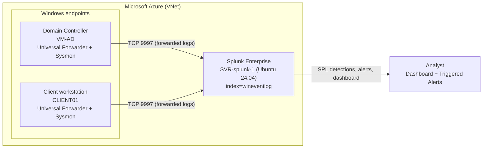

The Windows endpoints run the Splunk Universal Forwarder and Sysmon, and forward their Security, System and Sysmon logs to the Splunk indexer over the private virtual network on TCP 9997. The indexer stores everything in the `wineventlog` index, where the detections run.

### Environment

| Component | Detail |
|---|---|
| Cloud platform | Microsoft Azure (Azure for Students) |
| SIEM server | Splunk Enterprise 10.6.1.1 on Ubuntu 24.04, Standard B2als v2 |
| Service account | Non-root `splunk` account, managed by systemd (`Splunkd.service`) |
| Log sources | Domain Controller (VM-AD) and a Windows client (CLIENT01) |
| Endpoint agents | Splunk Universal Forwarder 10.6.1.1 and Sysmon (SwiftOnSecurity config) |
| Transport | Forwarder to indexer over private VNet, TCP 9997 |
| Index | `wineventlog` |

> Public IP addresses, the Azure subscription ID and the admin source address have been redacted from the screenshots. The lab domain accounts (for example `svc_test`) are fictional and kept visible on purpose.

## Detections and MITRE ATT&CK mapping

Each detection is a saved SPL search. The query files are in [`detections/`](detections/).

| Detection | Windows event | MITRE technique | Query |
|---|---|---|---|
| Brute-force sign-ins | 4625 (failed logon) | T1110 Brute Force | [01](detections/01-brute-force-4625.spl) |
| Account lockout | 4740 | T1110 Brute Force | [02](detections/02-account-lockout-4740.spl) |
| Privileged group change | 4728 / 4732 / 4756 | T1098 Account Manipulation | [03](detections/03-privilege-escalation-4728-4732-4756.spl) |
| New account created | 4720 | T1136 Create Account | [04](detections/04-new-account-4720.spl) |
| Encoded PowerShell | Sysmon 1 | T1059.001 PowerShell | [05](detections/05-encoded-powershell-sysmon1.spl) |
| Service installation | 7045 | T1543.003 Windows Service | [06](detections/06-service-install-7045.spl) |

## How it was built

### Phase 1 and 2: Provision and install Splunk

An Ubuntu 24.04 VM was provisioned in Azure and locked down with a network security group that allows SSH (22) and Splunk Web (8000) only from the admin address, and the forwarder receiving port (9997) only from inside the virtual network.

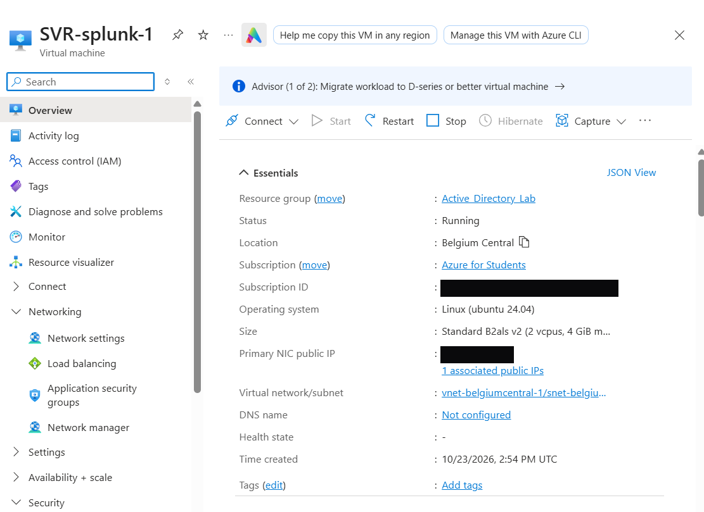

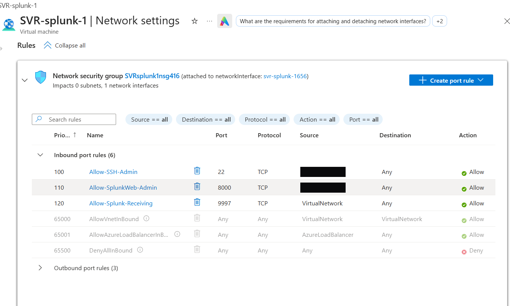

Splunk Enterprise was installed and run as a dedicated non-root `splunk` service account under systemd, then enabled for boot-start.

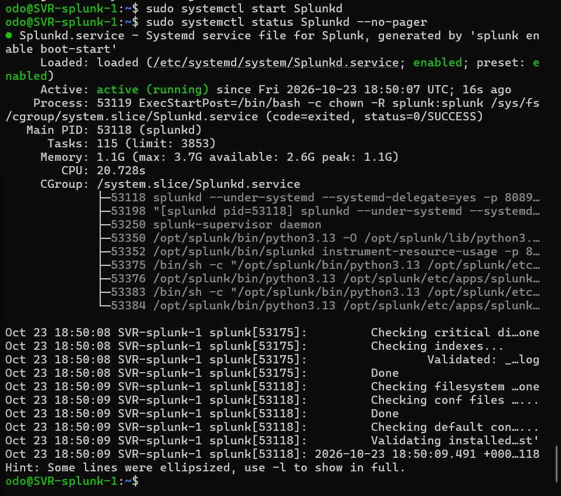

### Phase 3: Instrument the endpoints

The Universal Forwarder and Sysmon were installed on both the Domain Controller and the client. Within minutes both hosts were forwarding Security, System and Sysmon logs into the `wineventlog` index.

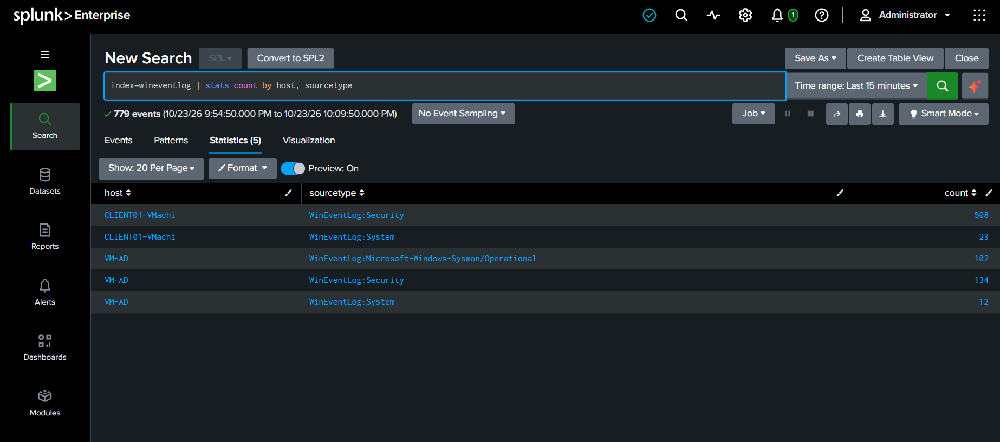

### Phase 4: Simulate attacks and detect them

With logs flowing, each attack was carried out against the domain and confirmed in Splunk.

**Brute force (T1110).** Repeated failed sign-ins against the `svc_test` account produced a cluster of 4625 events, counted per account and source.

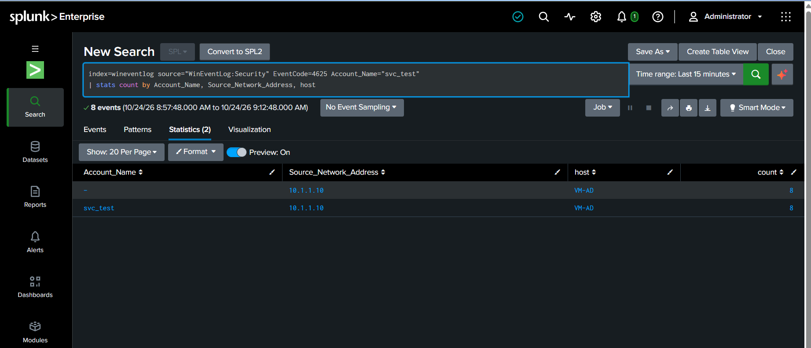

**Account lockout (T1110).** The brute force tripped the account lockout policy, raising a 4740 event.

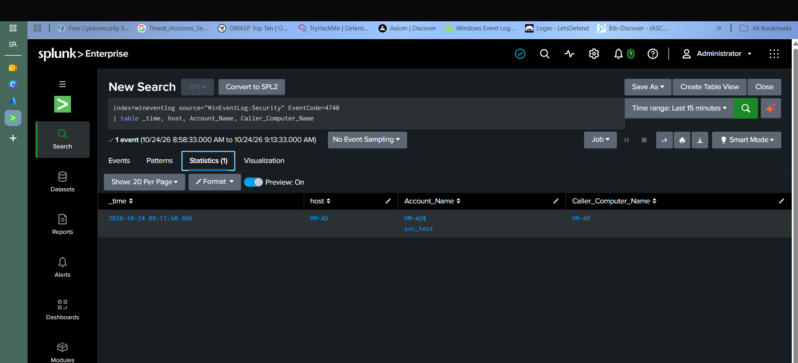

**Privilege escalation (T1098).** Adding the test account to Domain Admins raised a privileged-group-change event (4728 / 4732 / 4756).

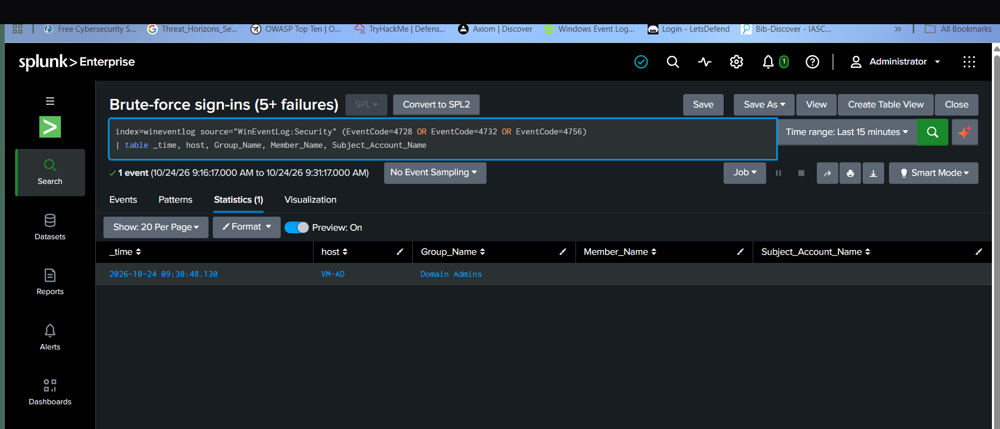

**Encoded PowerShell (T1059.001).** A PowerShell process launched with an encoded command was captured by Sysmon Event 1.

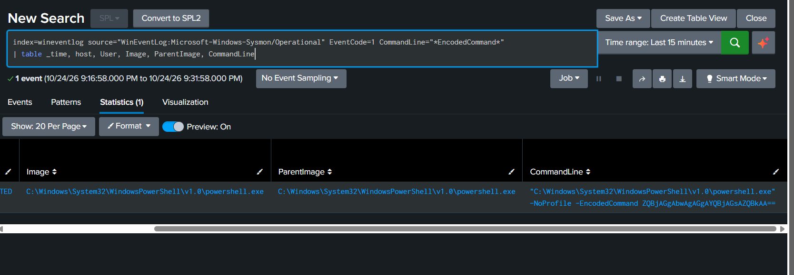

**Service installation (T1543.003).** Installing a new Windows service raised a 7045 event.

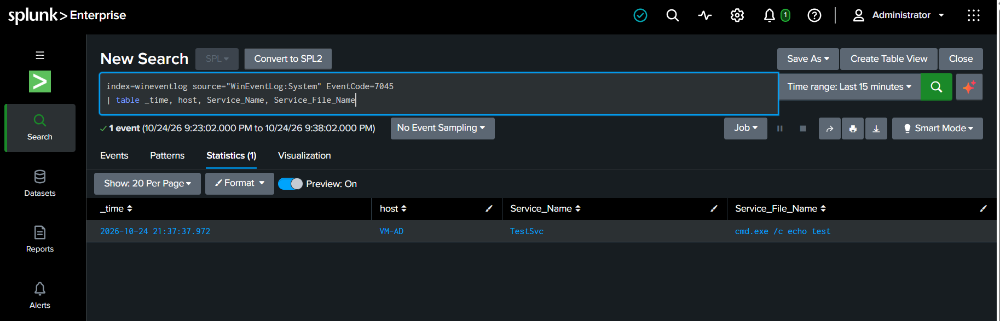

### Scheduled alerting

The brute-force detection was saved as a scheduled alert running every five minutes (`*/5 * * * *`), triggering when the search returns more than zero results and adding each hit to Triggered Alerts at High severity.

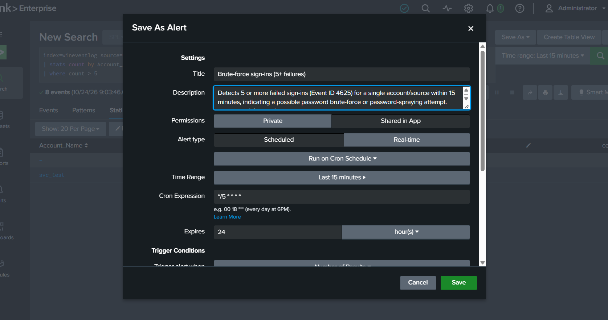

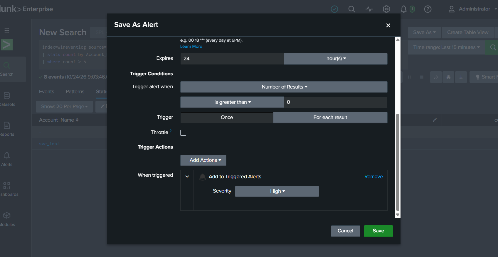

### Phase 5: Build the monitoring dashboard

The detections were assembled into one Classic dashboard, built up one panel at a time so each panel keeps its own underlying search:

1. Run the first detection search and set the time range to **Last 24 hours**.
2. **Save As > Dashboard Panel > New**, title the dashboard *Windows Security Monitoring*, name the panel (for example *Failed sign-ins by account (4625) - T1110*), and choose a visualisation (statistics table, or column chart for the event-volume panel).
3. For every remaining detection, run its search and **Save As > Dashboard Panel > Existing**, selecting the same dashboard and titling the panel with its event ID and MITRE technique.
4. Open the dashboard and use **Edit** to arrange the panels into rows.

The result is a single view an analyst can work from, with all seven detections populated by the simulated attacks.

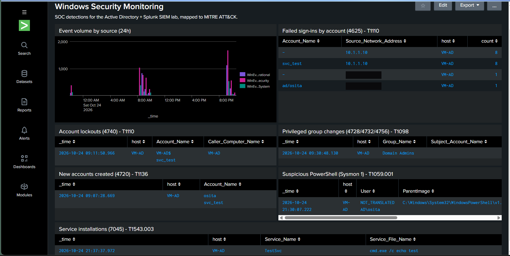

A Classic (Simple XML) dashboard was chosen over Dashboard Studio so the dashboard source can be exported and version-controlled, which makes it reproducible by anyone who clones this repository.

## Challenges and resolutions

Every phase hit at least one real problem. Working through them was the point of the lab.

| Phase | Challenge | Resolution |
|---|---|---|
| 2 (install) | `apt` could not resolve `archive.ubuntu.com`. The VNet DNS was pointed at the Domain Controller, which was switched off. | Pointed the interface at Azure's resolver with `sudo resolvectl dns eth0 168.63.129.16`, then retried the install. |
| 2 (install) | Splunk 10 refuses to run as `root`. | Created a dedicated service account (`useradd -r -s /bin/bash splunk`), ran `chown -R splunk:splunk /opt/splunk`, and started Splunk as that user. |
| 2 (boot-start) | `enable boot-start` failed with "splunk is currently running, stop it first". | Stopped Splunk, ran `enable boot-start -user splunk -systemd-managed 1`, then `systemctl start Splunkd`. |
| 3 (forwarding) | The Security sourcetype appeared to be missing in a 15-minute window, which looked like a forwarding fault. | Widened the search to 60 minutes. The events were present (over 500), it was simply a quiet window. No fix needed beyond confirming the pipeline. |
| 4 (attack sim) | `New-ADUser` was rejected because the domain password policy requires 14 characters, leaving the account half-created. | Set a compliant password with `Set-ADAccountPassword` and enabled the account with `Enable-ADAccount`. |

## Repository structure

```
splunk/
├── README.md
├── detections/      # SPL detection queries, one per technique
├── config/          # Universal Forwarder inputs.conf and outputs.conf
└── images/          # Redacted screenshots used in this README
```

## Skills demonstrated

- Deploying and hardening a Splunk Enterprise SIEM on Linux in Azure, running as a non-root systemd service
- Centralised Windows log collection with the Universal Forwarder and Sysmon
- Writing SPL detections for Windows and Sysmon events and mapping them to MITRE ATT&CK
- Simulating brute force, privilege escalation, suspicious PowerShell and service-persistence attacks, and verifying detection end to end
- Scheduled alerting and dashboard design for a working analyst view
- Azure networking and cost control (NSG rules, private forwarding, deallocating VMs when idle)

## Related projects

- [Azure Active Directory Lab](https://github.com/Osita-Odo/azure-active-directory-lab) - the Windows domain that feeds this SIEM.
- [Microsoft Sentinel SOC Lab](../sentinel/README.md) - the same detections rebuilt in a cloud-native SIEM.
- [SIEM labs overview](../README.md) - how the two labs compare.
